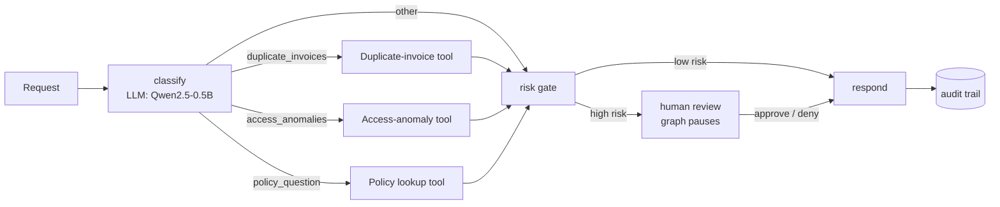

# LangGraph Ops Agent

[](https://github.com/achux11/langgraph-ops-agent/actions/workflows/ci.yml)


**A LangGraph agent for back-office requests.** It sends each request to the right tool, **pauses for human approval** before acting on risky results, and logs every step so each decision can be traced. It's evaluated against a labeled golden set and tested in CI.

> "Did we pay any vendor twice?" → finds the duplicate invoices → high dollar exposure → **waits for a human** → responds, with the full audit trail.

---

## Architecture



| Component | How it works |
|---|---|
| **State graph** | 7 nodes with conditional routing (`StateGraph`) |
| **Human-in-the-loop** | `interrupt_before=["human_review"]` with a `MemorySaver` checkpointer. The run pauses, a person approves or denies, and the run resumes |
| **Tool calling** | Deterministic Python tools that never change the source data |
| **Guardrails** | An invalid LLM output falls back to a safe classifier. Out-of-scope requests, unknown policies, high dollar exposure and any access anomaly all go to a human |
| **Traceability** | Every node appends `{step, detail, timestamp}` to the state's audit trail |

---

## Results

Results from `run_eval.py` on a **60-request hand-labeled golden set** (4 intents, 15 each):

| Metric | Value |
|---|---|
| Intent routing accuracy | _[from run_eval.py]_ |
| Invalid LLM outputs caught by the fallback | _[ ]_ |
| Escalated to human review | _[ ]_ |
| Median end-to-end latency | _[ ] ms_ |
| Tokens per request / estimated cost | _[ ]_ |

---

## Sample run (`FAKE_LLM=1 python demo.py`)

```text
Request : Did we pay any vendor twice this quarter?
Intent  : duplicate_invoices
Human   : paused for review -> APPROVED
Trail   : classify -> tool:duplicate_invoices -> risk_gate -> human_review -> respond

Request : What is the rule for expenses above 5000?
Intent  : policy_question
Human   : not needed (low risk)
Trail   : classify -> tool:policy -> risk_gate -> respond

Request : Who logged into the ERP at 3am?
Intent  : access_anomalies
Human   : paused for review -> DENIED
Response: Escalated: waiting for or denied human approval.
```

---

## Testing and CI

| Layer | What's covered |
|---|---|
| **Unit tests** (`tests/test_tools.py`, 4) | Duplicate detection, clean-data case, anomaly detection, policy fallback |
| **Integration tests** (`tests/test_graph.py`, 5) | The full graph end to end: routing, human approve and deny, low-risk path skips review, out-of-scope escalation, audit trail on every run |
| **CI** (`.github/workflows/ci.yml`) | GitHub Actions runs all tests on every push with a fake LLM, so no model download is needed |
| **LLM eval** (`run_eval.py`) | Golden-set accuracy, escalations, latency, tokens and cost with the real model |

---

## Quick start

```bash
git clone https://github.com/achux11/langgraph-ops-agent.git
cd langgraph-ops-agent
pip install -r requirements.txt

FAKE_LLM=1 pytest -v        # 9 tests, no model download
FAKE_LLM=1 python demo.py   # instant demo
python run_eval.py          # real LLM evaluation (GPU recommended, e.g. Google Colab T4)
```

## Project structure

```
agent.py        LangGraph state graph, risk gate, human-in-the-loop, audit trail
llm.py          Qwen2.5-0.5B-Instruct classifier + fallback guardrail + fake LLM for tests
tools.py        Duplicate invoices, access anomalies, policy lookup
data.py         Synthetic invoices, access logs, policies (no real data)
run_eval.py     60-case golden-set evaluation
demo.py         3-request walkthrough with decision trail
tests/          Unit + integration tests
```

## Design choices
- **Small open model:** a 0.5B model runs on a free GPU, so there are no API costs and no data leaves the machine. The fallback guardrail covers its mistakes.
- **Deterministic tools:** the LLM only decides which tool to run. Numbers come from code, not generated text, which removes hallucination risk for facts.
- **Pause before acting:** risky actions need a recorded human decision, which suits regulated and finance workflows.

## Next steps
- Add an LLM-as-a-judge step to grade response quality
- Persist the audit trail to a database and add a review UI
- Expose the agent as an MCP server so other assistants can call it

---
**Author:** Achintya Vamshi Nudurupati · [GitHub @achux11](https://github.com/achux11) · [LinkedIn](https://linkedin.com/in/achintya11)
All data is synthetic.
